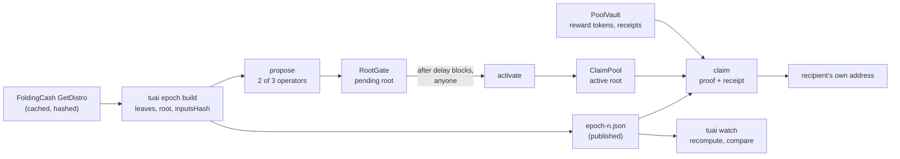

# Tuai: pull-based reward claims for FoldingCash

Entry for **BCH BLAZE 2026**, bounty "Trust-minimized, pull-based reward claims for FoldingCash".

Claim page: <https://tuai.sasateguh.com> (chipnet demonstration). Slides: [`docs/deck.pdf`](docs/deck.pdf) (8 pages).

## Reviewer guide

A five-minute path through the working system, all on chipnet:

1. Open <https://tuai.sasateguh.com/#/activity>. Every transaction of the chipnet runs is listed in order (deploy,
   propose, the early activations the node refused, activate, claims, the refused double claim, epoch 2, push), each
   with its size, fee and an explorer link; refused ones show the node's message instead of a link.
2. Open <https://tuai.sasateguh.com> and press **Try a demo address**, which picks a leaf that still has tokens
   to claim (or paste any address from
   [`deployments/chipnet/epoch-2.json`](deployments/chipnet/epoch-2.json)). The page finds the leaf, rebuilds the
   Merkle root in the browser and compares it with the root the pool holds on chain, then shows the cumulative,
   claimed and claimable amounts from the vault receipt.
3. Press **Claim now**. A chipnet relayer pays the fee and dust; the contract still pays the tokens only to the
   leaf's address. The page shows the txid with an explorer link, and the claim then appears on the activity page.
   The first claim made this way, checked on chain, is
   `2b6a7acc0963b14c0a227014eca58bf0c9b931dd9c26f90d6ce808111d582a9f`
   ([`docs/MEASURED.md`](docs/MEASURED.md#chipnet-claims-from-the-page)).
4. Press **Try to claim again** on the same leaf. The second claim is refused by the contract and by the node, and
   the page shows both messages.
5. In a clone: `npm ci && npm test` (offline), then
   `npx tsx bin/tuai.ts epoch verify deployments/chipnet/epoch-2.json` to rebuild the published root from its inputs.

When the relayer is empty, busy or switched off, the page says so and shows the CLI command instead of the button.

## What it is

FoldingCash pays `FLDCH` tokens to Folding@home contributors by sending one output per recipient every period. Tuai
replaces that push with a pull: two of three operators publish one Merkle root of cumulative rewards on Bitcoin Cash,
the root becomes claimable only after an audit window, and each contributor claims their own share with a proof that a
CashScript contract checks, paying the tokens only to the address in their leaf.



## Design in one screen

- **Leaf:** `sha256(0x00 || method(1) || uint64le(cumulative) || lockingBytecode)`; inner node:
  `sha256(0x01 || left || right)`. The prefixes keep leaves and nodes in separate domains.
- **Root gate:** a new root needs 2 of 3 operator signatures and becomes claimable only after a relative block
  timelock. Anyone can activate it after the delay.
- **Claim pool:** pays `cumulative - alreadyClaimed` to the locking bytecode in the leaf, so whoever submits a claim
  cannot redirect the payment. Receipts stay inside the contract as a sorted linked list.
- **Operator push:** once a root has been active for `pushDelay` blocks with no newer proposal, anyone may arm
  pushes; then a push pays a balance of at least `pushMinimum` to the leaf's locking bytecode, using the same
  receipts as claims, with dust and fee taken from BCH the operator left in the vault (ADR
  [0008](docs/decisions/0008-operator-push.md)).
- **Inputs hash:** each root is committed on chain together with the hash of its input manifest, so anyone can
  recompute it from the published files.
- **Contracts:** [`ClaimPool.cash`](contracts/ClaimPool.cash) checks claims,
  [`PoolVault.cash`](contracts/PoolVault.cash) holds reward tokens and receipts,
  [`RootGate.cash`](contracts/RootGate.cash) holds the pending root and enforces 2 of 3 and the delay.

Full format and transaction reference: [`docs/SPEC.md`](docs/SPEC.md). Decisions and rejected alternatives:
[`docs/decisions/`](docs/decisions/).

## Bounty requirements

Chipnet transactions below are from the demonstration recorded in [`docs/MEASURED.md`](docs/MEASURED.md#chipnet)
(300 leaves, depth 9, two epochs). Explorer links are in that table.

| Requirement | Where | Tests | Chipnet evidence |
|---|---|---|---|
| Merkle root of (address, cumulative earned) published each epoch | [`src/epoch/`](src/epoch/), [`src/merkle/`](src/merkle/), [`RootGate.propose`](contracts/RootGate.cash) | `tests/merkle.test.ts`, `tests/cumulative.test.ts`, `tests/epoch-watch.test.ts` | epoch 1 proposed `72b5fbf76e2a5dfb14932ffe69db28e034cde7724cfac08cea7078217b7efa48`, epoch 2 proposed `9bbc758dd43b721a9526e251acd7eb19fc8c2fab8bd7f146acbcfddd94fb2c34` |
| Pool contract holds the tokens and verifies a proof on every claim; funds do not expire | [`ClaimPool.claim`](contracts/ClaimPool.cash), [`PoolVault`](contracts/PoolVault.cash), [`src/tx/claim.ts`](src/tx/claim.ts) | `tests/claim-pool.test.ts`, `tests/vault-topup.test.ts` | deploy `6356165de951e6a7e4765151250eec97d853a368da5d11106865307a9ef40cec`; first claims `bdb7b8f1e6e03691dc379c8c8fa5834425a75d2580df6a2d5f9a5eca071d6ca4` (leaf 0), `aded1114eb0c2cfb9ad61cc6258fd379bb16b23df1544c4fa65f78ffe5c1cd2f` (leaf 150), `e7b5780761a0c254d4db380051d2c616d31c3f560dee796955479a936c73038f` (leaf 299) |
| No double claims (receipt with the claimed amount) | receipt list in [`ClaimPool.claim`](contracts/ClaimPool.cash), ADR [0002](docs/decisions/0002-claim-pool-and-receipts.md) | `tests/claim-pool.test.ts` ("rejects a second claim of the same amount", "rejects a burned receipt") | second first claim for leaf 0 refused by the network (`mandatory-script-verify-flag-failed`), row 20 of the table; top-up claims paid only the difference: `3b891a54a58dab33e147e6cb723241d2b8385f161d7fc18a7ef12cd27fed3c36` |
| Timelock on root updates (audit window) | [`RootGate.activate`](contracts/RootGate.cash), ADR [0003](docs/decisions/0003-root-gate.md) | `tests/root-gate.test.ts`, `tests/sequence-time.test.ts` | seven early activations refused with `non-BIP68-final` (rows 6 to 13); accepted `5003786414a7babd59114603a497f9435c6b75989da9a8f183def325df7cd35a` and `d3217738961f951e97890fdf0782b5091a28bc38f247b820b80ab6af63bf93a3` |
| No claim threshold; the claimant pays dust and fee | [`src/tx/claim.ts`](src/tx/claim.ts), `payment > 0` in [`ClaimPool.claim`](contracts/ClaimPool.cash) | `tests/claim-pool.test.ts` | fees and dust came from each claim's own funding input (the project payer key or a demo key), not from the pool; leaf 0's top-up was funded by leaf 150's key and still paid leaf 0 |
| Reference transaction-building code, chipnet demo of several hundred leaves, cost comparison with push | [`src/tx/`](src/tx/), [`bin/tuai.ts`](bin/tuai.ts), [`docs/MEASURED.md`](docs/MEASURED.md), [`docs/COST.md`](docs/COST.md) | `tests/cli-e2e.test.ts`, `tests/cost.test.ts`, `tests/chipnet-record.test.ts` | all 24 attempts with full txids in [`docs/MEASURED.md`](docs/MEASURED.md#chipnet) |

### Optional and stretch items

Every optional and stretch item on the bounty page, built or not:

| Item | Status | Where | Evidence |
|---|---|---|---|
| Proof-serving endpoint (optional) | built | static files under `/epochs/<network>/` from [`scripts/web-epochs.ts`](scripts/web-epochs.ts), see [Proof endpoint](#proof-endpoint) | `curl -s https://tuai.sasateguh.com/epochs/chipnet/epoch-2.json`; `tests/web-epochs.test.ts` |
| Simple claim UI or CLI (optional) | built, both | [`web/`](web/) (English and Malay), [`bin/tuai.ts`](bin/tuai.ts) | <https://tuai.sasateguh.com>; `e2e/`; `tests/cli-e2e.test.ts` |
| Relayer that submits claims, paying only the user's address (optional) | built on chipnet, triggered by the user | [`src/relay/`](src/relay/), ADR [0009](docs/decisions/0009-chipnet-relayer.md) | page claim `2b6a7acc0963b14c0a227014eca58bf0c9b931dd9c26f90d6ce808111d582a9f`; `tests/relay.test.ts`, `tests/relay-http.test.ts`, `e2e/relay.spec.ts` |
| Claim with the user's own wallet (usability) | built on chipnet, not yet run with a real wallet | [`src/relay/prepare.ts`](src/relay/prepare.ts) (unsigned claim from the wallet's coins), [`web/src/wallet-check.ts`](web/src/wallet-check.ts) (the page checks every input and output), [`web/src/wizardconnect.ts`](web/src/wizardconnect.ts), ADR [0012](docs/decisions/0012-wallet-claims.md) | `tests/wallet-claim.test.ts` (fake wallet signs, VM accepts; wrong key, redirected payment, skimmed change and foreign input refused) |
| Auto-claim when a balance crosses a threshold the user chose (optional) | built on chipnet, one pass per run of `tuai relay --optins <file>` | [`src/relay/service.ts`](src/relay/service.ts) `autoClaim`, [`src/relay/optins.ts`](src/relay/optins.ts), ADR [0010](docs/decisions/0010-relayer-auto-claim.md) | auto-claim `4997b741bac51ce4dae947276b1d7820638d986b8213725f95361b11d834d788`, two leaves skipped below their thresholds ([MEASURED](docs/MEASURED.md#chipnet-auto-claims-by-threshold)); `tests/relay-auto.test.ts` |
| Cumulative-only roots (stretch) | built | [`src/epoch/`](src/epoch/), `alreadyClaimed` in the receipt | top-up claim `3b891a54a58dab33e147e6cb723241d2b8385f161d7fc18a7ef12cd27fed3c36` paid only the epoch 2 difference |
| Watcher with input snapshot hash published with the root (stretch) | built | inputs hash in the state NFT, [`src/watch/`](src/watch/), [Watcher](#watcher) | [`reports/watch-chipnet.json`](reports/watch-chipnet.json), [`docs/MEASURED.md`](docs/MEASURED.md#watcher) |
| Independently verifiable links for compatibility users (stretch) | built, off chain | [`src/link/`](src/link/), `tuai link sign`/`tuai link verify`, `tuai watch --links`, [SPEC section 8](docs/SPEC.md#8-signed-compatibility-links), ADR [0011](docs/decisions/0011-signed-compatibility-links.md) | `tests/link.test.ts` (wallet signed message vector; other address, other name, tampered signature and other domain refused) |
| Operator push path after a long timelock, with a minimum (stretch) | built | `RootGate.arm`, push branch of [`ClaimPool.claim`](contracts/ClaimPool.cash), [`src/tx/push.ts`](src/tx/push.ts), ADR [0008](docs/decisions/0008-operator-push.md) | second chipnet pool (`tuai --run push`): arm `a7087d2fd81c54eb5136b7de3836b2b67ba4efadc2b67d35b9d1de00d023dd32`, push `5fc63b2474f735cecd558e43b017c52d43a7120dd2b13f47fd5ed1c6481f42e0` paid from the vault's BCH; an early arm and a push below the minimum refused ([`docs/MEASURED.md`](docs/MEASURED.md#chipnet-operator-push)) |
| Merkle depth and VM limit analysis (stretch) | built | [`docs/DEPTH.md`](docs/DEPTH.md), `npm run claim-sizes` | claim size per depth and the depth at which each VM limit binds |

The 300-leaf chipnet pool runs the version 1 contracts, deployed before the push path; the push path ran on the
second chipnet pool of five leaves.

## Open questions answered

- **Epoch cadence.** Monthly, matching the sponsor's live distributions (one per month in
  [`docs/COST.md`](docs/COST.md)). The operator cost per epoch does not depend on the number of recipients, so a
  shorter cadence costs the operators only two more transactions per epoch; claimants are not affected because a
  claim collects every epoch since the last one.
- **Scale.** `tree.maxDepth` is 24 (16,777,216 leaves). Each level adds one 32-byte sibling to a claim; the binding
  VM limit is the 10,000-byte unlocking bytecode, reached at depth 292 by linear extrapolation
  ([`docs/DEPTH.md`](docs/DEPTH.md)). All claims spend the one state UTXO, so they are serialized (they can chain
  within a block).
- **Root authority.** 2 of 3 operator keys propose; the root becomes claimable after `delay` blocks (144 in
  production, about one day) and anyone can activate it. The delay is an audit window, not a veto.
- **Receipt layout.** `key(32) || next(32) || claimed(8 LE)` with `key = sha256(lockingBytecode)`, kept in the vault
  as a list sorted by key. A first claim spends its predecessor as proof that no receipt exists yet. Receipts never
  sit in the claimant's wallet, so burning one cannot reset a claim (ADR [0002](docs/decisions/0002-claim-pool-and-receipts.md)).
- **Leaf contents.** Link method (1 byte), cumulative amount (8 bytes), locking bytecode. The method byte records
  how the address was linked, so a watcher knows which leaves it can check.
- **Link verification.** Method 0 (address in the Folding@home name) is checked by `tuai watch --fah` against the
  public daily file. Method 1 (FoldingCash's own mapping) is checked by `tuai watch --links` against a BCH signed
  message from the linked address naming the Folding@home user, published with the epoch inputs
  ([SPEC section 8](docs/SPEC.md#8-signed-compatibility-links)). Method 1 leaves without one are listed as unverified.

## Trust boundaries

- **Contracts enforce:** the payment amount and destination, one receipt per locking bytecode, 2 of 3 signatures for
  a new root, the delay before it pays, and that pool tokens leave only through claims and pushes (which pay the same
  leaf and update the same receipt). Nothing in the contracts
  lets anyone withdraw the pool, so unclaimed rewards stay claimable.
- **Operators decide:** the content of each root. Two operators can publish a wrong root; the inputs hash and the
  delay make it visible before it pays, but do not block it.
- **FoldingCash decides:** eligibility and amounts (the distribution API) and method 1 address links. The Folding@home
  daily files are taken as published.
- **Recipients and relayers:** anyone may submit a claim, an activation, an arm or a push; none can change where
  tokens go. A push may spend up to `pushSats` of the vault's BCH; the operator decides how much BCH to leave there.
- **The chipnet demo relayer** holds one chipnet key with a small balance and nothing else (no operator, payer or
  mainnet key). It checks every output before sending (leaf, pool, vault or its own change; the exact token amount;
  a fee cap) as a second guard behind the contracts. It runs only on chipnet: the network is a constant in code and
  the config must list chipnet alone (ADR [0009](docs/decisions/0009-chipnet-relayer.md)).

## Cost

From [`docs/COST.md`](docs/COST.md) (generated from measured sizes and live mainnet distributions; price and time of
measurement are in that file):

- **Operators:** 2,709 sat per epoch (propose 1,025 bytes, activate 1,684 bytes), whatever the number of recipients.
  Push at 1,000 recipients: 1,077,187 sat per epoch in fees and dust.
- **Recipients:** a first claim at depth 9 was 1,899 bytes on chipnet, paid by the claimant together with 1,000 sat
  of receipt dust; a later top-up claim was 1,748 bytes. From 100 recipients up, a recipient who claims once every 3
  epochs or less often costs no more in fees and dust than the pushes it replaces.
- Push is cheaper for very small recipient lists, which is what the sponsor runs today (1 to 3 recipients per month).

## Run it

Requires Node 22.

```sh
npm ci
npm test            # every unit, contract and CLI test (offline, mock network)
npm run demo:mock   # the full CLI flow on the mock network: deploy, propose, activate, claims, epoch 2, watch
npx tsx bin/tuai.ts epoch verify deployments/chipnet/epoch-2.json   # rebuild the chipnet root from committed inputs
```

Other scripts: `npm run vectors` (test vectors), `npm run contracts` (compile `contracts/*.cash`),
`npm run claim-sizes` (sizes and `docs/DEPTH.md`), `npm run cost` (`docs/COST.md`), `bash scripts/gerbang-ujian.sh`
(lint, typecheck, contract compile check, tests).

### Claim page

`npm run web:dev` serves the claim page from `web/`; `npm run web:build` writes it to `dist/` together with the
committed epoch files under `/epochs/<network>/`. Enter an address (q or z, with or without the prefix): the page
finds the leaf, recomputes the root in the browser, compares it with the root the pool holds on chain (read over an
Electrum WebSocket), shows the claimed and claimable amounts from the vault receipt, and gives the claim command. A
root that differs from the published file is shown as a named warning. English and Malay. `npm run e2e` runs the
browser tests on WebKit (iPhone 13) and Chromium. The page runs at <https://tuai.sasateguh.com>; see [ADR 0007](docs/decisions/0007-claim-page.md).
On chipnet the address card also offers **Claim now**, sent by the demo relayer (`GET /api/relay/status`,
`POST /api/relay/claim`), and **Try to claim again** on a claimed leaf, which shows the contract's and the node's
refusal; see [ADR 0009](docs/decisions/0009-chipnet-relayer.md) and [Trust boundaries](#trust-boundaries).

The result also lists the address's cumulative amount in every published epoch and the top-up each epoch added.
The **Activity** page (<https://tuai.sasateguh.com/#/activity>) lists every recorded transaction of every chipnet
run in the order it was sent, with an explorer link, size and fee; transactions the node refused are shown with the
node's message and no link. `scripts/tx-index.ts` builds that list from each `deployments/<run>/transactions.json`
and the site serves it as `/epochs/<network>/transactions.json`. Below the record, the page reads the pool
contract's history over Electrum and lists any transaction the record does not hold, such as a claim made later.

### Proof endpoint

The same static site serves the published epoch files, so any wallet, script or other site can fetch a proof's
inputs without running the CLI:

```
https://tuai.sasateguh.com/epochs/<network>/index.json      # {"network": ..., "epochs": [...]}
https://tuai.sasateguh.com/epochs/<network>/pool.json       # contract addresses, token category, deploy txid
https://tuai.sasateguh.com/epochs/<network>/epoch-<n>.json  # leaves, root, inputsHash, manifest
https://tuai.sasateguh.com/epochs/<network>/inputs/<file>   # hashed inputs the epoch was built from
https://tuai.sasateguh.com/epochs/<network>/transactions.json  # every recorded transaction, by run
```

```sh
curl -s https://tuai.sasateguh.com/epochs/chipnet/index.json
curl -s https://tuai.sasateguh.com/epochs/chipnet/epoch-2.json | jq -r .root
npx tsx bin/tuai.ts epoch verify deployments/chipnet/epoch-2.json   # in a clone: the same root, rebuilt from inputs
```

The files are the ones committed under [`deployments/`](deployments/). They are sent with open CORS for `GET`, a
short cache lifetime and `no-transform`, so a CDN does not rewrite them. The files are not trusted on their own: the
page and the CLI compare the root they compute with the root the pool holds on chain. Deployment is one static
container ([`deploy/`](deploy/), [`Dockerfile`](Dockerfile)) that holds no keys.

### Watcher

Anyone can check the operators without trusting them. `tuai watch --network chipnet --deployment deployments/chipnet`
reads the pool state NFT from every recorded propose and activate transaction and compares its root and inputs hash
with values rebuilt from the committed epoch files and inputs; any difference exits 1 and is named.
`npm run watch-report` also downloads the public Folding@home daily summary once, rebuilds the sponsor's real push
distributions as an off-chain epoch and checks each leaf's method 0 link. The tracked
[`reports/watch-chipnet.json`](reports/watch-chipnet.json) holds only roots, hashes and counts; results per address stay
local. The last run is in [`docs/MEASURED.md`](docs/MEASURED.md#watcher).

### Command line

`npx tsx bin/tuai.ts <command> [--network chipnet|mainnet|mock] [--json]` (see
[ADR 0004](docs/decisions/0004-epoch-files-and-cli.md)). Keys are read from `state/keys/` and never printed. Exit
codes: 0 done, 1 failed or a difference found, 2 usage, 3 not yet possible (timelock, API interval). `--run <name>`
keeps a second pool on the same network in its own record (`state/runs/<network>-<name>.json`,
`deployments/<network>-<name>/`).

```sh
tuai epoch build --source api --start 2026-10-01T00:00:00Z --end 2026-11-01T00:00:00Z --amount 1000
tuai epoch build --source fixture --file allocations.json [--previous deployments/chipnet/epoch-1.json]
tuai epoch verify <epoch file>          # rebuild a root from its inputs
tuai watch --epoch <file> [--fah daily_user_summary.txt]   # recompute, check links, compare with chain
tuai watch --deployment deployments/chipnet   # every epoch's root and inputs hash on chain vs recomputed
tuai token genesis --amount <units>     # test reward token held by the payer key
tuai deploy [--vault-sats N]            # pool, vault, receipt list head and root gate in one transaction
tuai propose --epoch <file> [--operators 1,3]   # two of three operators
tuai activate                           # anyone, once the pending root is old enough
tuai claim <address> --epoch <file> [--payer <key>]   # pays the leaf's own address
tuai arm                                # anyone, once the active root stood pushDelay blocks
tuai push <address> --epoch <file>      # pays a balance of at least pushMinimum; the vault's BCH pays the fee
tuai relay --optins <file> [--dry-run]  # chipnet relayer: claim for opted-in leaves at or above their threshold
tuai status                             # payer balance, active and pending roots, blocks left
tuai budget                             # mainnet spending against the configured limit
tuai fund demo-5 [--sats N]             # BCH between project keys only
tuai demo allocations --round 1|2 --out <file>   # demonstration tree (ADR 0006)
tuai demo double-claim <address> --epoch <file>  # records the refusal of a second claim
```

## Integrating with FoldingCash

[`docs/INTEGRATION.md`](docs/INTEGRATION.md): the distribution API becomes the input of each epoch, the release
contract's fund key sends each period's tokens to the pool vault, and the per-epoch operator steps.

## Configuration

Every value that can change (networks, Electrum servers, timelock lengths, push delay, minimum and BCH limit, tree depth, operator keys, fee and dust
values, sponsor API settings, mainnet spending limit) lives in [`config/tuai.json`](config/tuai.json). CLI text lives
in [`lang/en.json`](lang/en.json) and [`lang/ms.json`](lang/ms.json).

## Known limits

- Claims are larger than a push output: about 1.9 kB for a first claim at depth 9. The contract was kept readable
  rather than hand-optimized; 20-byte receipt keys and a hand-written script are recorded options in ADR 0002.
- All claims go through one state UTXO, so two claims in the same moment conflict and one must be rebuilt.
- Operator keys are fixed in the gate. Rotating them means a new deployment.
- The CLI signs a proposal with two operator key files on one machine.
- A signed link proves that the key of a method 1 address names a Folding@home user, not that the user controls that
  Folding@home account, and the contracts do not require one: an unverified method 1 leaf still pays.
- The sponsor's October 2026 distribution had one recipient, so the chipnet tree uses five project demo keys and
  295 synthetic leaves nobody holds a key for (ADR [0006](docs/decisions/0006-chipnet-demonstration.md)). No real
  participant's address is in the demonstration.
- Chipnet nodes read a block-count sequence lock as ten one-minute blocks per unit at the time of the demonstration,
  so the demo delay of 3 took 30 blocks (ADR 0006).
- The 300-leaf chipnet demonstration ran the version 1 contracts (kept in `src/contracts/artifacts/v1/`); the push
  path ran on a second chipnet pool of five leaves. Pushes open only between `pushDelay` blocks after activation and the next proposal.
- The demonstration runs on chipnet only. The claim page claims through the chipnet demo relayer, through the
  user's own WizardConnect wallet on chipnet, or shows the CLI command. No wallet claim from a real wallet is
  recorded yet; the wallet path is tested with an in-process fake wallet. The relayer claims when a user presses the button,
  or for leaves in an opt-in file the relayer operator holds once their threshold is reached (`tuai relay`); a
  signed opt-in request from the leaf holder is not built.

## AI disclosure

The code and documents in this repository were written by an AI coding agent working under the direction of the
repository owner. The owner chose the problem, set the requirements and constraints, and reviews the results.
On-chain measurements in `docs/MEASURED.md` come from transactions the tools in this repository broadcast.

## License

MIT, see [LICENSE](LICENSE). The page loads the WizardConnect libraries (`@wizardconnect/core`,
`@wizardconnect/dapp`, LGPL-3.0) unmodified from npm, as a separate file, only for a wallet claim.
