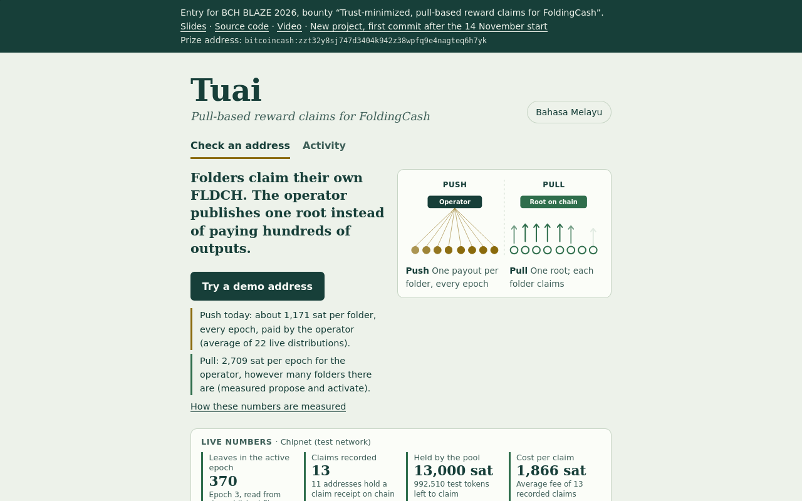
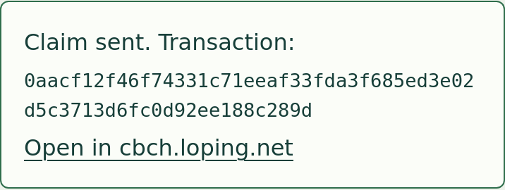

<p align="center"></p>

<h1 align="center">Tuai</h1>

<p align="center"><a href="https://github.com/aimanmalib/tuai/actions/workflows/test.yml"></a> <a href="LICENSE"></a> <a href="https://tuai.sasateguh.com"></a> <a href="https://tuai.sasateguh.com/#/activity/mainnet"></a></p>

<p align="center"><b>Tuntutan ganjaran secara tarik untuk FoldingCash: operator menerbitkan satu akar, dan setiap folder menuntut FLDCH sendiri.</b> · <i>Pull-based reward claims for FoldingCash: the operator publishes one root, and each folder claims their own FLDCH.</i><br>
<a href="https://tuai.sasateguh.com"><b>halaman tuntutan</b></a> · <a href="#cuba-dalam-lima-minit">Cuba</a> · <a href="#jalankan-sendiri">Jalankan</a> · <a href="#ujian">Ujian</a> · <a href="#had">Had</a> · <a href="README.md">English</a><br>
Dibina di Malaysia oleh <a href="https://aimanmalib.com">Aiman Malib</a> · <a href="https://sasateguh.com">Sasa Teguh</a></p>

Ini ringkasan Bahasa Melayu bagi [README.md](README.md). Spesifikasi, angka ukuran dan setiap txid ada dalam versi
Inggeris dan `docs/`; jika kedua-duanya berbeza, versi Inggeris yang terpakai.

Entri **BCH BLAZE 2026**, ganjaran "Trust-minimized, pull-based reward claims for FoldingCash". Projek baharu: komit
pertama repositori ini dibuat pada 17 November 2026, selepas acara bermula pada 14 November
([komit pertama](https://github.com/aimanmalib/tuai/commit/d99169c7796262077826e106bf1e017ea30b005a)).
Alamat hadiah dan undian EMBER2026 entri ini: `bitcoincash:zzt32y8sj747d3404k942z38wpfq9e4nagteq6h7yk`.



## Apa ia

FoldingCash membayar token `FLDCH` kepada penyumbang Folding@home dengan menghantar satu output bagi setiap penerima
setiap tempoh (tolak). Tuai menggantikannya dengan tarik: dua daripada tiga operator menerbitkan satu akar Merkle
ganjaran kumulatif di Bitcoin Cash, akar itu hanya boleh dituntut selepas tetingkap audit, dan setiap penyumbang
menuntut bahagian sendiri dengan bukti yang disemak kontrak CashScript. Kontrak membayar token hanya ke alamat dalam
daun penerima itu, jadi sesiapa yang menghantar tuntutan tidak boleh mengalihkan bayaran.

- **Gerbang akar:** akar baharu perlu tandatangan 2 daripada 3 operator dan hanya aktif selepas kunci masa blok.
- **Kolam tuntutan:** membayar `kumulatif - sudahDituntut` kepada skrip penguncian dalam daun; resit kekal dalam kontrak.
- **Hash input:** setiap akar dicatat di rantaian bersama hash manifes inputnya, jadi sesiapa boleh mengira semula.
- Kontrak: [`ClaimPool.cash`](contracts/ClaimPool.cash), [`PoolVault.cash`](contracts/PoolVault.cash),
  [`RootGate.cash`](contracts/RootGate.cash). Spesifikasi penuh: [`docs/SPEC.md`](docs/SPEC.md).

## Cuba dalam lima minit

1. Buka https://tuai.sasateguh.com. Bahagian atas menerangkan Tuai dalam satu ayat dan melukis tolak di sebelah tarik
   dengan kos masing-masing, diikuti angka hidup yang halaman itu baca sendiri dari chipnet.
2. Tekan **Try a demo address**. Halaman mencari daun, membina semula akar Merkle dalam pelayar dan membandingkannya
   dengan akar yang kolam pegang di rantaian.
3. Tekan **Claim now**. Relayer chipnet membayar yuran; kontrak tetap membayar token hanya ke alamat daun itu.
4. Tekan **Try to claim again**: tuntutan kedua ditolak oleh kontrak dan nod, dan halaman menunjukkan kedua-dua mesej.
5. Buka https://tuai.sasateguh.com/#/activity untuk setiap transaksi chipnet, dan
   https://tuai.sasateguh.com/#/activity/mainnet untuk larian mainnet dengan token ujian projek.



Halaman ini dalam bahasa Inggeris dan Melayu. Bila relayer kosong, sibuk atau dimatikan, halaman memberitahunya dan
menunjukkan arahan CLI sebagai ganti butang.

## Jalankan sendiri

Perlu Node 22.

```sh
npm ci
npm test            # setiap ujian unit, kontrak dan CLI (luar talian, rangkaian olok-olok)
npm run demo:mock   # aliran CLI penuh di rangkaian olok-olok: deploy, propose, activate, tuntutan, epoch 2, watch
npx tsx bin/tuai.ts epoch verify deployments/chipnet/epoch-2.json   # bina semula akar chipnet dari input yang dikomit
```

## Ujian

`npm test` menjalankan setiap ujian unit, kontrak dan CLI luar talian, termasuk larian aliran penuh di rangkaian
olok-olok. `.github/workflows/test.yml` menjalankan `npm ci` dan `npm test` yang sama pada setiap push dan pull request;
lencana di atas menunjukkan larian terkini. Rekod chipnet dan mainnet dengan setiap txid: [`docs/MEASURED.md`](docs/MEASURED.md).

## Had

- Tuntutan lebih besar daripada satu output tolak (kira-kira 1.9 kB bagi tuntutan pertama pada kedalaman 9).
- Kolam satu serpihan menghantar setiap tuntutan melalui satu UTXO keadaan, jadi dua tuntutan serentak bercanggah dan
  satu mesti dibina semula. Tiada kolam berserpihan telah dijalankan di chipnet.
- Kunci operator tetap dalam gerbang; menukarnya bermakna deployment baharu.
- Pertanyaan pengeluaran penaja memulangkan satu penerima untuk Oktober 2026, jadi epoch 1 dan 2 di chipnet memakai kunci demo projek dan
  daun sintetik; token di chipnet ialah token ujian projek, dan tiada sesiapa dalam projek menuntut daun peserta.
- Di mainnet, empat tuntutan tarik berjalan dengan token ujian projek sendiri, bukan token ganjaran sebenar. Tolak,
  tambahan dan relayer hanya di chipnet.
- Tuntutan dompet hanya di chipnet, dan Cashonize ialah satu-satunya dompet pihak ketiga yang dicuba.
- Senarai penuh: [README.md](README.md#known-limits).

## Pendedahan AI

Kod dan dokumen dalam repositori ini ditulis oleh ejen pengekodan AI di bawah arahan pemilik repositori. Pemilik memilih
masalah, menetapkan keperluan dan kekangan, dan menyemak hasilnya. Ukuran di rantaian dalam `docs/MEASURED.md` datang
daripada transaksi yang disiarkan oleh alat dalam repositori ini.

## Lesen

MIT, lihat [LICENSE](LICENSE). Halaman memuatkan pustaka WizardConnect (`@wizardconnect/core`, `@wizardconnect/dapp`,
LGPL-3.0) tanpa diubah dari npm, sebagai fail berasingan, hanya untuk tuntutan dompet.

## Bekerja dengan Sasa Teguh

Saya membina projek ini. Saya menjalankan [Sasa Teguh](https://sasateguh.com), sebuah studio di Malaysia yang membina laman web
yang ditemui di Google dan dalam jawapan AI, serta menyediakan sistem seperti ini untuk perniagaan.

[Tempah panggilan](https://sasateguh.com/book) · hello@sasateguh.com · [Lagi dari Sasa Teguh](https://github.com/sasateguh)
