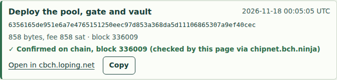
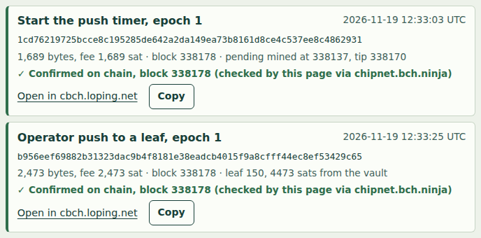
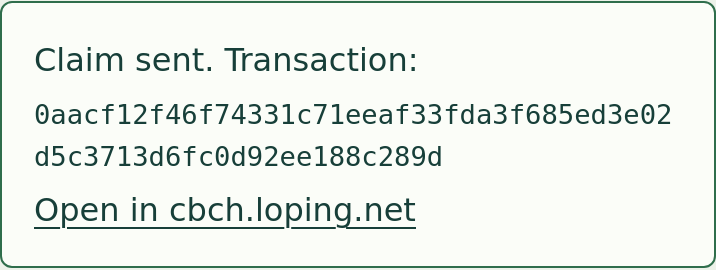
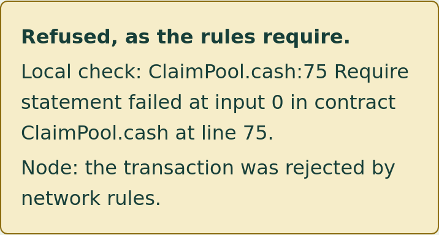
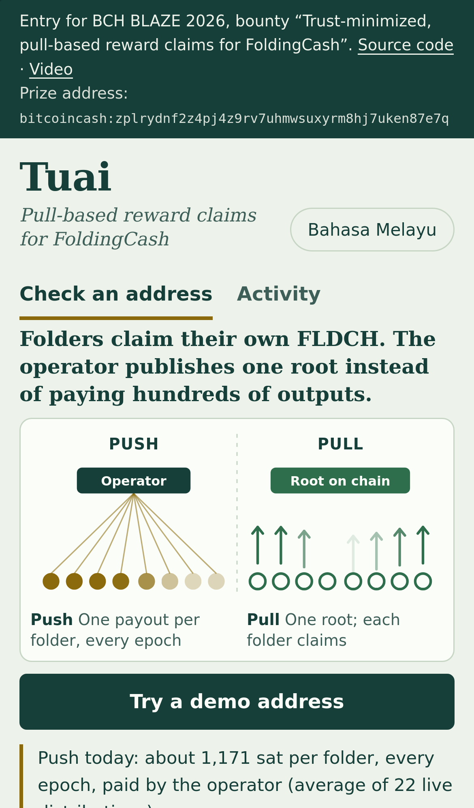
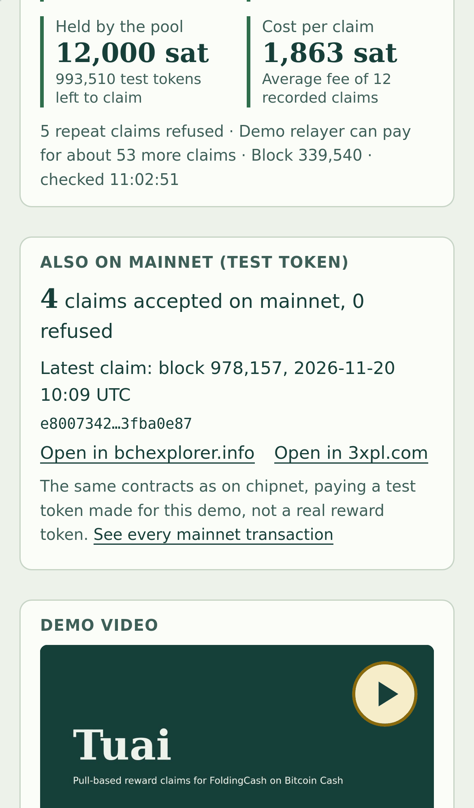

# Measured

Facts measured on live systems, with times in UTC. Failures are recorded too.

## Sponsor distribution API

| When (UTC) | Query | Result |
|---|---|---|
| 2026-11-17 15:15:32 | `GET https://api.folding.cash/v1/GetDistro?startDate=2026-10-01T00:00:00Z&endDate=2026-11-01T00:00:00Z&amount=1000&includeFoldingUserTypes=8` | HTTP 200 in 0.9 s; `distroCount` 1, `totalPoints` 2,589,653, `totalWorkUnits` 18, `totalDistro` 1000; response SHA-256 `f7f256ebea85619177301032531be30506b654329062b53db0f6af57de4334d4` |

For October 2026 the sponsor's own distribution query (folding user type 8) has one recipient, so the chipnet
demonstration adds project demo keys and synthetic leaves to reach at least 300 leaves.

The live response stays in the operator's local API cache and is not committed, because it names a real
participant's address. The committed example,
[`deployments/fixtures/example-distro/epoch-1.json`](../deployments/fixtures/example-distro/epoch-1.json), is built
from [`examples/distro-example.json`](../examples/distro-example.json): the same response shape with three synthetic
recipients written by `scripts/example-distro.ts`. Rebuild and check it with
`npx tsx bin/tuai.ts epoch verify deployments/fixtures/example-distro/epoch-1.json`.

## Sponsor push distributions on mainnet

Measured 2026-11-17 16:14 UTC by `npm run push-measure`: the public indexer returned 100 candidate transactions for
the reward token category; each was read from Electrum `bch.imaginary.cash` and 22 have the push distribution layout
(one per month from 2025-01-11 to 2026-10-13, 1 to 3 recipients each, 262 to 557 bytes, fee = size + 1 sat, 1,000
sat of dust per recipient). Every txid, size and fee is in [`reports/push-distributions.json`](../reports/push-distributions.json)
and in the table of [`COST.md`](COST.md). BCH price at the same time: 208.16 USD (CoinGecko simple price API).

An earlier run on the same day read every candidate but failed on exit (`Manual connection management is disabled` when
closing the Electrum connection); the script now opens one managed connection and the rerun above completed.

## Watcher

Run on 2026-11-18 by `npm run watch-report`; aggregates in [`reports/watch-chipnet.json`](../reports/watch-chipnet.json).

- **Roots on chain.** For epochs 1 and 2 of the chipnet deployment the watcher read the pool state NFT from the
  recorded propose and activate transactions (Electrum `chipnet.bch.ninja`) and recomputed root and inputs hash from
  the committed epoch files and inputs. All four pairs match (03:41 UTC); `tuai watch --network chipnet --deployment
  deployments/chipnet` gives the same result.
- **Folding@home daily summary.** `https://apps.foldingathome.org/daily_user_summary.txt.bz2` downloaded once at
  2026-11-18 03:40:15 UTC: 28,753,037 bytes, SHA-256 `135703b69c1d9f01c1afa705f86231f38ad495adb1d470d962724385eb3f3c64`
  (server Last-Modified 2026-11-18 03:32:57 UTC). The file is public and changes daily, so it is kept by the operator
  and identified here by hash rather than committed.
- **Replay of real push distributions.** The 22 push distributions in `reports/push-distributions.json` were read
  from Electrum `bch.imaginary.cash` and rebuilt as one off-chain epoch: 45 payouts to 6 distinct recipients, replay
  root `d0506d1aa4d08cd6e143dc8ce724fac13d1384fe7dc1e0d7734a7c0e88bb4773`. Treating every leaf as link method 0, all 6
  addresses appear in a name of the daily summary; none was unlinked. The per-leaf result stays local because it pairs
  addresses with Folding@home names.

## Chipnet

Run on 2026-11-18 with the committed CLI from the project's own chipnet keys. Contracts and parameters:
[`deployments/chipnet/pool.json`](../deployments/chipnet/pool.json). Epoch files (300 leaves, depth 9, every leaf
with its proof): [`epoch-1.json`](../deployments/chipnet/epoch-1.json) and
[`epoch-2.json`](../deployments/chipnet/epoch-2.json); recompute either with
`npx tsx bin/tuai.ts epoch verify deployments/chipnet/epoch-2.json`. The five project demo keys sit at leaves 0, 1,
150, 298 and 299; the other 295 leaves pay synthetic scripts nobody holds a key for (ADR 0006). No real
participant's address is in epochs 1 and 2; epoch 3 adds the sponsor's real distributions (see
[Real distribution epoch (chipnet)](#real-distribution-epoch-chipnet)).

What the record below shows:

- **Root authority.** Epoch 1 was proposed with operator keys 1 and 3, epoch 2 with keys 2 and 3 (2-of-3).
- **Timelock.** Early activations were refused by the network with `non-BIP68-final`, including one forced
  attempt one block before the lock ended. Chipnet nodes require ten one-minute blocks per unit of a block-count
  sequence lock, so the demo delay of 3 means 30 blocks (measurements and reasoning in ADR 0006). Two probes
  were accepted outside the CLI from a one-off script used to find the rule, so they are not in the table. On coins
  mined at 336009: spends with sequence 3 and then sequence 1 were refused (tip 336015); a spend with sequence 0
  was accepted (`0674a0c44b2f263c1bf9991e048d43c722f411ec8cb37b8ebf67ddf73c3effc0`); a spend with sequence 1 was
  accepted with the tip at 336018 (`84b1c80568a0e96d22dc087b0ccb08c52f5180f4f0b01c2900ac18f856383b1d`).
- **Activation by anyone.** Activations were funded by the payer key, which holds no operator key.
- **Claims.** Each claim paid the leaf's full unclaimed amount to the leaf's own address; the claimant paid the fee
  and dust. Leaf 150's claim was funded by its own demo key; leaf 0's epoch 2 top-up was funded by a different
  demo key (leaf 150's), and the tokens still went to leaf 0's address.
- **Double claim.** A second first claim for leaf 0 (a duplicate receipt) was refused by the local VM at the
  `target < upper` check of `contracts/ClaimPool.cash` and by the network (`mandatory-script-verify-flag-failed`).
- **Epoch 2.** Cumulative amounts carried over; top-up claims paid only the difference.
- **Watcher.** `npx tsx bin/tuai.ts watch --epoch deployments/chipnet/epoch-2.json --network chipnet` after the
  epoch 2 activation recomputed the root from the committed inputs and found it active on chain (`matched: true`,
  no findings).

Generated by `npx tsx scripts/chain-report.ts chipnet` from the operator's run log, with block heights read from
Electrum and each size checked against the network's. Machine-readable copy:
[`deployments/chipnet/transactions.json`](../deployments/chipnet/transactions.json).

<!-- chipnet-transactions:start -->
| # | When (UTC) | Step | Transaction | Bytes | Fee (sat) | Block | Result |
|---|---|---|---|---|---|---|---|
| 1 | 2026-11-18 00:04:49 | prepare-genesis | [`14ec5fc2d31da0300dfdeb2bd64bc6b292af5c01e8e0c59bc1274a659e3e18a3`](https://cbch.loping.net/tx/14ec5fc2d31da0300dfdeb2bd64bc6b292af5c01e8e0c59bc1274a659e3e18a3) | 185 | 185 | 336009 | accepted |
| 2 | 2026-11-18 00:04:51 | token-genesis | [`bfb4f1c59e36eb87b65ffdc3fe0b246200f9e6810ad42ce994e8c9c151a6b0a1`](https://cbch.loping.net/tx/bfb4f1c59e36eb87b65ffdc3fe0b246200f9e6810ad42ce994e8c9c151a6b0a1) | 262 | 262 | 336009 | accepted |
| 3 | 2026-11-18 00:05:02 | prepare-genesis | [`9d4957d2e44390960854d1e39b7ed9c800cff956568b776abd064aa1cc9f31a6`](https://cbch.loping.net/tx/9d4957d2e44390960854d1e39b7ed9c800cff956568b776abd064aa1cc9f31a6) | 185 | 185 | 336009 | accepted |
| 4 | 2026-11-18 00:05:05 | deploy | [`6356165de951e6a7e4765151250eec97d853a368da5d11106865307a9ef40cec`](https://cbch.loping.net/tx/6356165de951e6a7e4765151250eec97d853a368da5d11106865307a9ef40cec) | 858 | 858 | 336009 | accepted |
| 5 | 2026-11-18 00:05:28 | propose-epoch-1 | [`72b5fbf76e2a5dfb14932ffe69db28e034cde7724cfac08cea7078217b7efa48`](https://cbch.loping.net/tx/72b5fbf76e2a5dfb14932ffe69db28e034cde7724cfac08cea7078217b7efa48) | 862 | 866 | 336009 | accepted (operators 1,3) |
| 6 | 2026-11-18 00:05:56 | activate-epoch-1 | not mined | 1473 | 1473 | - | refused: BIP68 sequence lock not satisfied: the transaction was rejected by network rules. non-BIP68-final (code 64) |
| 7 | 2026-11-18 00:06:01 | fund-demo-5 | [`6c35e14b8d8ea4778e59620eabc8ce7c81a48600811cfff1655f8dd27fcc6228`](https://cbch.loping.net/tx/6c35e14b8d8ea4778e59620eabc8ce7c81a48600811cfff1655f8dd27fcc6228) | 219 | 219 | 336009 | accepted |
| 8 | 2026-11-18 00:07:49 | activate-epoch-1 | not mined | 1473 | 1473 | - | refused: BIP68 sequence lock not satisfied: the transaction was rejected by network rules. non-BIP68-final (code 64) |
| 9 | 2026-11-18 00:08:53 | activate-epoch-1 | not mined | 1473 | 1473 | - | refused: BIP68 sequence lock not satisfied: the transaction was rejected by network rules. non-BIP68-final (code 64) |
| 10 | 2026-11-18 00:15:05 | activate-epoch-1 | not mined | 1473 | 1473 | - | refused: BIP68 sequence lock not satisfied: the transaction was rejected by network rules. non-BIP68-final (code 64) |
| 11 | 2026-11-18 00:18:07 | activate-epoch-1 | not mined | 1473 | 1473 | - | refused: BIP68 sequence lock not satisfied: the transaction was rejected by network rules. non-BIP68-final (code 64) |
| 12 | 2026-11-18 00:34:48 | activate-epoch-1 | not mined | 1473 | 1473 | - | refused: BIP68 sequence lock not satisfied: the transaction was rejected by network rules. non-BIP68-final (code 64) |
| 13 | 2026-11-18 00:36:30 | activate-epoch-1 | not mined | 1473 | 1473 | - | refused: BIP68 sequence lock not satisfied: the transaction was rejected by network rules. non-BIP68-final (code 64) |
| 14 | 2026-11-18 00:37:07 | activate-epoch-1 | [`5003786414a7babd59114603a497f9435c6b75989da9a8f183def325df7cd35a`](https://cbch.loping.net/tx/5003786414a7babd59114603a497f9435c6b75989da9a8f183def325df7cd35a) | 1473 | 1473 | 336043 | accepted (pending mined at 336009, tip 336038) |
| 15 | 2026-11-18 00:37:27 | claim-first-epoch-1 | [`bdb7b8f1e6e03691dc379c8c8fa5834425a75d2580df6a2d5f9a5eca071d6ca4`](https://cbch.loping.net/tx/bdb7b8f1e6e03691dc379c8c8fa5834425a75d2580df6a2d5f9a5eca071d6ca4) | 1899 | 1899 | 336043 | accepted (leaf 0) |
| 16 | 2026-11-18 00:37:38 | claim-first-epoch-1 | [`7b2850831200d256386e285572b6af14e59372b1908edd1b4fbb7bfec73d4f3d`](https://cbch.loping.net/tx/7b2850831200d256386e285572b6af14e59372b1908edd1b4fbb7bfec73d4f3d) | 1899 | 1899 | 336043 | accepted (leaf 1) |
| 17 | 2026-11-18 00:37:49 | claim-first-epoch-1 | [`aded1114eb0c2cfb9ad61cc6258fd379bb16b23df1544c4fa65f78ffe5c1cd2f`](https://cbch.loping.net/tx/aded1114eb0c2cfb9ad61cc6258fd379bb16b23df1544c4fa65f78ffe5c1cd2f) | 1901 | 1901 | 336043 | accepted (leaf 150) |
| 18 | 2026-11-18 00:38:02 | claim-first-epoch-1 | [`0041367c3339669e209e168e6ebec362b74e43e481279a662db1cc3ff499d039`](https://cbch.loping.net/tx/0041367c3339669e209e168e6ebec362b74e43e481279a662db1cc3ff499d039) | 1901 | 1901 | 336043 | accepted (leaf 298) |
| 19 | 2026-11-18 00:38:16 | claim-first-epoch-1 | [`e7b5780761a0c254d4db380051d2c616d31c3f560dee796955479a936c73038f`](https://cbch.loping.net/tx/e7b5780761a0c254d4db380051d2c616d31c3f560dee796955479a936c73038f) | 1901 | 1901 | 336043 | accepted (leaf 299) |
| 20 | 2026-11-18 00:38:55 | double-claim-epoch-1 | not mined | 1899 | 1899 | - | refused: local: ClaimPool.cash:75 Require statement failed at input 0 in contract ClaimPool.cash at line 75.; network: the transaction was rejected by network rules. mandatory-script-verify-flag-failed (Script |
| 21 | 2026-11-18 00:39:38 | propose-epoch-2 | [`9bbc758dd43b721a9526e251acd7eb19fc8c2fab8bd7f146acbcfddd94fb2c34`](https://cbch.loping.net/tx/9bbc758dd43b721a9526e251acd7eb19fc8c2fab8bd7f146acbcfddd94fb2c34) | 862 | 866 | 336043 | accepted (operators 2,3) |
| 22 | 2026-11-18 01:08:22 | activate-epoch-2 | [`d3217738961f951e97890fdf0782b5091a28bc38f247b820b80ab6af63bf93a3`](https://cbch.loping.net/tx/d3217738961f951e97890fdf0782b5091a28bc38f247b820b80ab6af63bf93a3) | 1473 | 1473 | 336076 | accepted (pending mined at 336043, tip 336072) |
| 23 | 2026-11-18 01:08:40 | claim-additional-epoch-2 | [`3b891a54a58dab33e147e6cb723241d2b8385f161d7fc18a7ef12cd27fed3c36`](https://cbch.loping.net/tx/3b891a54a58dab33e147e6cb723241d2b8385f161d7fc18a7ef12cd27fed3c36) | 1748 | 1748 | 336076 | accepted (leaf 0) |
| 24 | 2026-11-18 01:09:03 | claim-additional-epoch-2 | [`9c0edf1cbb7803e643b50c9bfd3ba9eac50b217b39686cfd84cc5ae6c6720164`](https://cbch.loping.net/tx/9c0edf1cbb7803e643b50c9bfd3ba9eac50b217b39686cfd84cc5ae6c6720164) | 1750 | 1750 | 336076 | accepted (leaf 299) |
| 25 | 2026-11-18 21:12:16 | fund-relay-chipnet | [`58ca9a8181e68dfdfec161853e745b850c4ea56d26052264337599c7ab36552e`](https://cbch.loping.net/tx/58ca9a8181e68dfdfec161853e745b850c4ea56d26052264337599c7ab36552e) | 219 | 219 | 337267 | accepted |
| 26 | 2026-11-20 14:44:38 | propose-epoch-3 | [`abbc9a133c387990b9403591200528d0db445a5aed18a3a9a879954467784fe1`](https://cbch.loping.net/tx/abbc9a133c387990b9403591200528d0db445a5aed18a3a9a879954467784fe1) | 861 | 864 | 339745 | accepted (operators 1,2) |
| 27 | 2026-11-20 15:21:54 | activate-epoch-3 | [`5068fd149578789262fe14f82b8a7875577dd9d0a930fafecd91c23ccb6811b5`](https://cbch.loping.net/tx/5068fd149578789262fe14f82b8a7875577dd9d0a930fafecd91c23ccb6811b5) | 1473 | 1473 | 339803 | accepted (pending mined at 339745, tip 339780) |
<!-- chipnet-transactions:end -->

## Real distribution epoch (chipnet)

Run on 2026-11-20 with the committed CLI on the chipnet pool that the claim page and relayer read
([`deployments/chipnet/epoch-3.json`](../deployments/chipnet/epoch-3.json), 370 leaves, depth 9).

- **Inputs.** Epoch 2 carried over (300 leaves, cumulative amounts unchanged or higher), then two responses of the
  sponsor's distribution endpoint for all user types, fetched once each through the cached, rate limited client
  (`npx tsx bin/tuai.ts epoch build --network chipnet --source api --real --file <wallet leaf> --previous
  deployments/chipnet/epoch-2.json`), then one allocations file for a third-party wallet's own address (leaf 251, the
  amount `demo.walletLeafWhole` from the config):

  | Query | Snapshot | Entries | SHA-256 of the stored response |
  |---|---|---|---|
  | `GET https://api.folding.cash/v1/GetDistro?startDate=2026-10-01T00:00:00Z&endDate=2026-11-01T00:00:00Z&amount=1000&includeFoldingUserTypes=15` | 2026-10-01 17:11:01 to 2026-11-01 10:39:27 UTC | 62 (61 legacy BTC, 1 CashTokens address) | [`a9dec677c572607bbe1002988d3a8559e304c67622c23c76b9c25f21091cd88c`](../deployments/chipnet/inputs/a9dec677c572607bbe1002988d3a8559e304c67622c23c76b9c25f21091cd88c.json) |
  | `GET https://api.folding.cash/v1/GetDistro?startDate=2026-11-01T00:00:00Z&endDate=2026-11-20T00:00:00Z&amount=1000&includeFoldingUserTypes=15` | 2026-11-01 10:39:27 to 2026-11-20 11:39:04 UTC | 56 (all legacy BTC) | [`ed44ff993d11a83f5d45e0d32ede8da8677e52c5a0c4c993d6cf08c8853d43b2`](../deployments/chipnet/inputs/ed44ff993d11a83f5d45e0d32ede8da8677e52c5a0c4c993d6cf08c8853d43b2.json) |
  | wallet leaf allocations | - | 1 | [`c88484040194994e1ff870dc8ca0e832d2736872b723593e7ed18e3b67425d5f`](../deployments/chipnet/inputs/c88484040194994e1ff870dc8ca0e832d2736872b723593e7ed18e3b67425d5f.json) |

  Together the two months name 69 distinct recipients (49 appear in both): 68 legacy BTC addresses, every one Base58Check
  P2PKH, which became method 2 leaves paying `76a914<hash160>88ac`, and 1 CashTokens address (method 0). Root
  `c4929769c990f49178dd618e3edc2ddb31d13a37880a4945ef19d0bb94462d70`, inputs hash
  `acc197b8f5aabc8c45d94d5bd09e90471cca4434a4b09b99079add6220168540`; `npx tsx bin/tuai.ts epoch verify
  deployments/chipnet/epoch-3.json` recomputes both.
- **Root authority.** Proposed with operator keys 1 and 2: `abbc9a133c387990b9403591200528d0db445a5aed18a3a9a879954467784fe1`
  (2026-11-20 14:44:38 UTC, block 339745). Activated after the delay by
  `5068fd149578789262fe14f82b8a7875577dd9d0a930fafecd91c23ccb6811b5` (2026-11-20 15:21:54 UTC). The pool's token
  balance already covered the new amounts, so no top-up was sent. Block heights are in the [Chipnet](#chipnet) table.
- **Failure on the way.** The activation stayed unconfirmed for 28 minutes (blocks 339782 to 339800) because it
  spends the pool state after two page claims from 2026-11-19 (`0aacf12f46f74331c71eeaf33fda3f685ed3e02d5c3713d6fc0d92ee188c289d`,
  `436da6e934211f6efcd047566bfcbb517e9b337b71038967eaacef2ad9b9ce19`) that were still unconfirmed: they sat only in the
  mempool of Electrum `chipnet.bch.ninja`, and `chipnet.imaginary.cash` did not know them. Sending the same three
  signed transactions to `chipnet.imaginary.cash` at 15:46 UTC was accepted, and all three were mined in block 339803.
- **Watcher.** `npx tsx bin/tuai.ts watch --network chipnet --epoch deployments/chipnet/epoch-3.json --fah
  daily_user_summary.txt.bz2 --json` with the Folding@home file identified under [Watcher](#watcher) (SHA-256
  `135703b69c1d9f01c1afa705f86231f38ad495adb1d470d962724385eb3f3c64`): legacy BTC leaves 68 of 68 carry their address
  in a Folding@home name, none missing. Of the method 0 leaves, the one real CashTokens address is in a name; the
  other 301 (project demo keys, the wallet leaf and synthetic leaves) are not, as expected, and are listed as findings,
  so the command exits 1. Root check after the activation: active epoch 3 on chain, `matched: true`.
- Nobody in the project claims a participant's leaf. The reward token on chipnet is the project's test token.

## Chipnet operator push

Run on 2026-11-18 with the committed CLI (`--run push`) from the project's own chipnet keys, to show the operator
push path of ADR [0008](decisions/0008-operator-push.md) on a real network. This is a second, smaller pool with the
version 2 contracts; the 300-leaf pool above keeps its version 1 contracts. Contracts and parameters (push delay 3,
push minimum and BCH limit from `config/tuai.json`):
[`deployments/chipnet-push/pool.json`](../deployments/chipnet-push/pool.json). Epoch file (five project demo keys,
two balances below the push minimum): [`epoch-1.json`](../deployments/chipnet-push/epoch-1.json). The deploy left
BCH with the reward tokens (`tuai deploy --vault-sats`) so pushes pay their dust and fee from the vault.

What the record below shows:

- **Push delay.** An arm sent right after the activation confirmed was refused by the network (`non-BIP68-final`);
  the arm after the delay was accepted.
- **Push minimum.** A push of a balance below the minimum, built with `tuai push --force` and sent without the local
  script check, was refused by the network. The CLI refuses it before sending without `--force`.
- **Push.** A balance above the minimum was pushed to the leaf's own address with no wallet input; the vault's BCH
  paid the dust and fee.
- **Pull still works.** The balance below the minimum was then claimed by an ordinary pull claim.

Generated by `npx tsx scripts/chain-report.ts chipnet push` from the operator's run log. Machine-readable copy:
[`deployments/chipnet-push/transactions.json`](../deployments/chipnet-push/transactions.json).

<!-- chipnet-push-transactions:start -->
| # | When (UTC) | Step | Transaction | Bytes | Fee (sat) | Block | Result |
|---|---|---|---|---|---|---|---|
| 1 | 2026-11-18 06:33:52 | prepare-genesis | [`5745ddb93df78406fdbf0b16d7d74964a76839bd2f746efae3a35ed731dfad49`](https://cbch.loping.net/tx/5745ddb93df78406fdbf0b16d7d74964a76839bd2f746efae3a35ed731dfad49) | 185 | 185 | 336402 | accepted |
| 2 | 2026-11-18 06:33:56 | token-genesis | [`aa1c5c4af246dbc0b1d784e145c3c77f4d3e6c089fb55c4dc64cb796bb005068`](https://cbch.loping.net/tx/aa1c5c4af246dbc0b1d784e145c3c77f4d3e6c089fb55c4dc64cb796bb005068) | 262 | 262 | 336402 | accepted |
| 3 | 2026-11-18 06:34:18 | prepare-genesis | [`99bf150551834802dda9fb0f2e712a3773f541728905846606f02bcecfe935f5`](https://cbch.loping.net/tx/99bf150551834802dda9fb0f2e712a3773f541728905846606f02bcecfe935f5) | 185 | 185 | 336402 | accepted |
| 4 | 2026-11-18 06:34:22 | deploy | [`152f133cbf09c7838ad6e1309e225ccb551b86bd282b7fdbc1be0e65de57b117`](https://cbch.loping.net/tx/152f133cbf09c7838ad6e1309e225ccb551b86bd282b7fdbc1be0e65de57b117) | 858 | 858 | 336402 | accepted |
| 5 | 2026-11-18 06:34:54 | propose-epoch-1 | [`f138cca88613543409a9380becbac8264e2cccdcd331796bc3bb442ad6d7b3a7`](https://cbch.loping.net/tx/f138cca88613543409a9380becbac8264e2cccdcd331796bc3bb442ad6d7b3a7) | 1024 | 1030 | 336402 | accepted (operators 1,2) |
| 6 | 2026-11-18 07:08:08 | activate-epoch-1 | [`7ad329860c61266cb76e6362b88776398aab453e1ca5e39a3fdd046fdfe5108e`](https://cbch.loping.net/tx/7ad329860c61266cb76e6362b88776398aab453e1ca5e39a3fdd046fdfe5108e) | 1688 | 1688 | 336441 | accepted (pending mined at 336402, tip 336433) |
| 7 | 2026-11-18 07:16:24 | arm-epoch-1 | not mined | 1689 | 1689 | - | refused: BIP68 sequence lock not satisfied: the transaction was rejected by network rules. non-BIP68-final (code 64) |
| 8 | 2026-11-18 07:44:45 | arm-epoch-1 | [`a7087d2fd81c54eb5136b7de3836b2b67ba4efadc2b67d35b9d1de00d023dd32`](https://cbch.loping.net/tx/a7087d2fd81c54eb5136b7de3836b2b67ba4efadc2b67d35b9d1de00d023dd32) | 1689 | 1689 | 336472 | accepted (pending mined at 336441, tip 336471) |
| 9 | 2026-11-18 07:46:39 | push-first-epoch-1 | not mined | 2278 | 2278 | - | refused: the transaction was rejected by network rules. mandatory-script-verify-flag-failed (Script failed an OP_VERIFY operation) (code 16) |
| 10 | 2026-11-18 07:46:58 | push-first-epoch-1 | [`5fc63b2474f735cecd558e43b017c52d43a7120dd2b13f47fd5ed1c6481f42e0`](https://cbch.loping.net/tx/5fc63b2474f735cecd558e43b017c52d43a7120dd2b13f47fd5ed1c6481f42e0) | 2278 | 2278 | 336474 | accepted (leaf 4, 4278 sats from the vault) |
| 11 | 2026-11-18 07:47:45 | claim-first-epoch-1 | [`cbf3836d89da6a4677a313ce35a92e5c8319ff2132ae0843365891fcc1f81e8c`](https://cbch.loping.net/tx/cbf3836d89da6a4677a313ce35a92e5c8319ff2132ae0843365891fcc1f81e8c) | 1757 | 1757 | 336474 | accepted (leaf 1) |
<!-- chipnet-push-transactions:end -->

## Chipnet operator push on the 300-leaf pool

Run on 2026-11-19 with the committed CLI (`--run push-tree`) from the project's own chipnet keys. It repeats the
operator push of the section above on a tree of the full demonstration size (`demo` in `config/tuai.json`: five
project demo keys at their configured indices among synthetic leaves with no key), so the push path is shown at the
same depth as the 300-leaf pool. Contracts and parameters:
[`deployments/chipnet-push-tree/pool.json`](../deployments/chipnet-push-tree/pool.json). Epoch file:
[`epoch-1.json`](../deployments/chipnet-push-tree/epoch-1.json). The same steps run on the mock network in
[`tests/push-300.test.ts`](../tests/push-300.test.ts).

What the record below shows:

- **Push at full depth.** The arm was sent after the push delay and accepted; the push of the demo key in the middle
  of the tree (`demo.keyIndices` in the config) was accepted with a Merkle proof of the full demonstration depth, paid
  to the leaf's own address with no wallet input, and its dust and fee came from the vault's BCH (row note).
- **Push minimum.** A push of a synthetic leaf whose balance is below the minimum was refused by the CLI, then built
  with `tuai push --force` and refused by the network (last row).

Generated by `npx tsx scripts/chain-report.ts chipnet push-tree` from the operator's run log. Machine-readable copy:
[`deployments/chipnet-push-tree/transactions.json`](../deployments/chipnet-push-tree/transactions.json).

<!-- chipnet-push-tree-transactions:start -->
| # | When (UTC) | Step | Transaction | Bytes | Fee (sat) | Block | Result |
|---|---|---|---|---|---|---|---|
| 1 | 2026-11-19 11:22:57 | prepare-genesis | [`12fa477a27c05116e24b7533a16bfc8a3efbd4eb565e896b4df9cb34853b1492`](https://cbch.loping.net/tx/12fa477a27c05116e24b7533a16bfc8a3efbd4eb565e896b4df9cb34853b1492) | 326 | 326 | 338103 | accepted |
| 2 | 2026-11-19 11:23:01 | token-genesis | [`f0080f1614797db35d1a802deac72a7167fc4aee2f48f2fc511fe3afec460f80`](https://cbch.loping.net/tx/f0080f1614797db35d1a802deac72a7167fc4aee2f48f2fc511fe3afec460f80) | 262 | 262 | 338103 | accepted |
| 3 | 2026-11-19 11:23:23 | prepare-genesis | [`784f639856525bbaf0d66f8f251e5c261a4f2aedb04fb1f4b4acfeb6ad0a0e64`](https://cbch.loping.net/tx/784f639856525bbaf0d66f8f251e5c261a4f2aedb04fb1f4b4acfeb6ad0a0e64) | 185 | 185 | 338103 | accepted |
| 4 | 2026-11-19 11:23:27 | deploy | [`aa9a353473a628ee5f5582aa11050d01658688080207b0b4a908a4900d249523`](https://cbch.loping.net/tx/aa9a353473a628ee5f5582aa11050d01658688080207b0b4a908a4900d249523) | 858 | 858 | 338103 | accepted |
| 5 | 2026-11-19 11:24:23 | propose-epoch-1 | [`781357aae6abb25d921140e9624638fe89eec926299b97beabd11afcb16a6ece`](https://cbch.loping.net/tx/781357aae6abb25d921140e9624638fe89eec926299b97beabd11afcb16a6ece) | 1026 | 1028 | 338103 | accepted (operators 1,2) |
| 6 | 2026-11-19 11:56:36 | activate-epoch-1 | [`607ce1a9251f00cbffb63b3a09710be73194cdb4d90f3df30615165ac4cccef5`](https://cbch.loping.net/tx/607ce1a9251f00cbffb63b3a09710be73194cdb4d90f3df30615165ac4cccef5) | 1688 | 1688 | 338137 | accepted (pending mined at 338103, tip 338135) |
| 7 | 2026-11-19 12:33:03 | arm-epoch-1 | [`1cd76219725bcce8c195285de642a2da149ea73b8161d8ce4c537ee8c4862931`](https://cbch.loping.net/tx/1cd76219725bcce8c195285de642a2da149ea73b8161d8ce4c537ee8c4862931) | 1689 | 1689 | 338178 | accepted (pending mined at 338137, tip 338170) |
| 8 | 2026-11-19 12:33:25 | push-first-epoch-1 | [`b956eef69882b31323dac9b4f8181e38eadcb4015f9a8cfff44ec8ef53429c65`](https://cbch.loping.net/tx/b956eef69882b31323dac9b4f8181e38eadcb4015f9a8cfff44ec8ef53429c65) | 2473 | 2473 | 338178 | accepted (leaf 150, 4473 sats from the vault) |
| 9 | 2026-11-19 12:33:57 | push-first-epoch-1 | not mined | 2467 | 2467 | - | refused: the transaction was rejected by network rules. mandatory-script-verify-flag-failed (Script failed an OP_VERIFY operation) (code 16) |
<!-- chipnet-push-tree-transactions:end -->

## Chipnet claims from the page

Claims made on the public claim page with "Claim now", fee paid by the chipnet demo relayer
(docs/decisions/0009-chipnet-relayer.md). Each transaction was read back from Electrum by `scripts/page-claims.ts`
before it was recorded: the leaf received exactly its cumulative amount minus what it had claimed, the other
outputs went to the deployment's own contracts, and the only remaining output was the relayer's change. The table
and list below are generated from `deployments/chipnet/page-claims.json`.

<!-- chipnet-page-transactions:start -->
| # | When (UTC) | Leaf address | Transaction | Bytes | Fee (sat) | Block | Tokens paid |
|---|---|---|---|---|---|---|---|
| 1 | 2026-11-18 21:45:50 | `bchtest:zz8fm0yp5j5as68vel8rvskv7xtz8xca8g90zrn4mm` | [`2b6a7acc0963b14c0a227014eca58bf0c9b931dd9c26f90d6ce808111d582a9f`](https://cbch.loping.net/tx/2b6a7acc0963b14c0a227014eca58bf0c9b931dd9c26f90d6ce808111d582a9f) | 1901 | 1901 | 337326 | 30400000000 |
| 2 | 2026-11-18 23:51:01 | `bchtest:zzde36p2dz0f0vr2w7txyjwpkk6whkucjvyw2efm8l` | [`99e747919759e690c3f9e20d852202b976944519513ae629a8e33e7f924ebb66`](https://cbch.loping.net/tx/99e747919759e690c3f9e20d852202b976944519513ae629a8e33e7f924ebb66) | 1901 | 1901 | 337491 | 5100000000 |
| 3 | 2026-11-19 13:10:16 | `bchtest:zztjtl2m2ru8c92g9x4e46x93mtsekzwfypf7xe6vn` | [`0aacf12f46f74331c71eeaf33fda3f685ed3e02d5c3713d6fc0d92ee188c289d`](https://cbch.loping.net/tx/0aacf12f46f74331c71eeaf33fda3f685ed3e02d5c3713d6fc0d92ee188c289d) | 1901 | 1901 | 339803 | 7600000000 |
| 4 | 2026-11-19 21:14:23 | `bchtest:zzgkjuxpfumnrt0np5qn3h3443kq490equ3w080ksd` | [`436da6e934211f6efcd047566bfcbb517e9b337b71038967eaacef2ad9b9ce19`](https://cbch.loping.net/tx/436da6e934211f6efcd047566bfcbb517e9b337b71038967eaacef2ad9b9ce19) | 1901 | 1901 | 339803 | 30900000000 |

"Try to claim again" on a claimed leaf, answered by the node and shown on the page:

- 2026-11-18 21:46:05 UTC, `bchtest:zz8fm0yp5j5as68vel8rvskv7xtz8xca8g90zrn4mm`: refused, `Local check: ClaimPool.cash:75 Require statement failed at input 0 in contract ClaimPool.cash at line 75. Node: the transaction was rejected by network rules.`
- 2026-11-18 23:51:16 UTC, `bchtest:zzde36p2dz0f0vr2w7txyjwpkk6whkucjvyw2efm8l`: refused, `Local check: ClaimPool.cash:75 Require statement failed at input 0 in contract ClaimPool.cash at line 75. Node: the transaction was rejected by network rules.`
- 2026-11-19 13:10:26 UTC, `bchtest:zztjtl2m2ru8c92g9x4e46x93mtsekzwfypf7xe6vn`: refused, `Local check: ClaimPool.cash:75 Require statement failed at input 0 in contract ClaimPool.cash at line 75. Node: the transaction was rejected by network rules.`
- 2026-11-19 21:14:36 UTC, `bchtest:zzgkjuxpfumnrt0np5qn3h3443kq490equ3w080ksd`: refused, `Local check: ClaimPool.cash:75 Require statement failed at input 0 in contract ClaimPool.cash at line 75. Node: the transaction was rejected by network rules.`
<!-- chipnet-page-transactions:end -->

## Chipnet auto-claims by threshold

`tuai relay --network chipnet --optins examples/relay-optins.json` (docs/decisions/0010-relayer-auto-claim.md) claims
for each opted-in leaf whose claimable amount, read from the pool and the leaf's receipt on chain, has reached the
leaf's own `minAmount`. The relayer key pays fee and dust; the contracts send the reward to the leaf. One pass on
2026-11-19 01:06:04 UTC with five opted-in demo leaves: two had nothing left to claim, one claim was sent (threshold
20000000000, claimable 25000000000), two were skipped below their thresholds (30000000000 and 100000000000, claimable
25000000000 each) and nothing was sent for them. Each sent transaction was read back from Electrum by
`scripts/page-claims.ts --kind auto` before it was recorded, with the same output checks as the page claims above.
The table is generated from `deployments/chipnet/auto-claims.json`.

<!-- chipnet-auto-transactions:start -->
| # | When (UTC) | Leaf address | Transaction | Bytes | Fee (sat) | Block | Tokens paid |
|---|---|---|---|---|---|---|---|
| 1 | 2026-11-19 01:06:03 | `bchtest:zp9pp55lnkj2p99hsvpaed95g2dx6e38xs5x0x0h7m` | [`4997b741bac51ce4dae947276b1d7820638d986b8213725f95361b11d834d788`](https://cbch.loping.net/tx/4997b741bac51ce4dae947276b1d7820638d986b8213725f95361b11d834d788) | 1748 | 1748 | 337555 | 25000000000 |
<!-- chipnet-auto-transactions:end -->

## Chain check on the live activity page

2026-11-19 10:16 UTC, deploy tag `04be8a3-202611191014`: the post-deploy browser test (`e2e/live.spec.ts`, Chromium
desktop and WebKit iPhone 13) opened the public activity page, which asked a chipnet Electrum server itself for the
recorded deploy transaction `6356165de951e6a7e4765151250eec97d853a368da5d11106865307a9ef40cec` and showed
"Confirmed on chain, block 336009 (checked by this page via chipnet.bch.ninja)", the same block as the record. No
listed transaction was left as "not in a block yet". The config lists one chipnet explorer: the other candidates
checked on 2026-11-19 did not show chipnet transactions (docs/decisions/0014-explorers-and-chain-check.md).

## Mainnet funding

Funding: 0.00015183 BCH received from a shared test wallet, txid
`3556624f0b790e53823d0a71a8ccd1362d638bb606cce6ca70018cb2ed3f816a`, for one mainnet claim with a test token.
The payment went to the project mainnet payer `bitcoincash:qrvp50lpgnehckax483xlc4zxjut2f9a8gg2glqv8p` and was mined
at 2026-11-19 17:02:59 UTC (block 978051, 7 confirmations when checked over Electrum `bch.imaginary.cash` at block
978057). `tuai status --network mainnet` then reported a payer balance of 15183 sat. The amount was sized as the
measured transaction sizes for prepare, token genesis, deploy without a vault top-up, propose, activate and one
depth-9 first claim (12146 sat at 1 sat per byte plus dust outputs) with a 25 percent margin. It is below the
mainnet spending limit of 100000 sat in `config/tuai.json`.

Funding: 0.00016671 BCH received from a shared test wallet, txid
`090838a38e75e6192dace0ea4f000f9027f3d2083ca584aa94094b1e7ab5df39`, for three more mainnet claims by project demo
keys. It was mined in block 978156 (2026-11-20 09:53:47 UTC, read over Electrum `bch.imaginary.cash`); the payer then
held 19880 sat. The amount was two measured first claims of the run above (3952 sat each with dust outputs) with a 25
percent margin, plus the 10000 sat the claim command sets aside as funding, less the 3209 sat left on the payer.

## Mainnet claim with a test token

Pull claims on mainnet with the project's own test token, not a real reward token: the first on 2026-11-19, three
more on 2026-11-20. The token
category `3556624f0b790e53823d0a71a8ccd1362d638bb606cce6ca70018cb2ed3f816a` was created by the project from the
funding output above (`tuai token genesis`). Pool record (contract addresses, operator keys, delays):
[`deployments/mainnet/pool.json`](../deployments/mainnet/pool.json). Epoch file:
[`epoch-1.json`](../deployments/mainnet/epoch-1.json), the 300-leaf demonstration tree at depth 9 with five project
demo keys and keyless synthetic leaves. No token was sent to an address outside the project's keys.

What the record below shows:

- **Root gate on mainnet.** Two of the three operator keys proposed the epoch 1 root; the activation was sent once
  the activation delay of 6 blocks had passed (row note: block of the proposal and tip at activation).
- **First claim.** The claim for leaf 299, held by a project demo key, paid the leaf's full cumulative amount of
  100000000000 base units to the leaf's own locking bytecode
  (`76a914faa95052063d5b9de92cbd1140ee55a3b0d29dca88ac`, output 2) and wrote the receipt into the vault's sorted list
  (outputs 3 and 4). The outputs were read back over Electrum `bch.imaginary.cash` after broadcast.
- **Three more claims.** Leaves 0, 1 and 150, each held by a project demo key, were claimed one after another with
  `tuai claim <address> --epoch deployments/mainnet/epoch-1.json --network mainnet`. Each claim spent the vault output
  the previous one created, so each new receipt went into the sorted list beside the earlier ones. All three were
  mined in block 978157 (2026-11-20 10:31:05 UTC). Read back over Electrum `bch.imaginary.cash` at 10:33 UTC, output 2
  of each paid 100000000000 base units of the test token category `3556624f…816a` to that leaf's own locking bytecode
  from the epoch file.
- **Spending.** `tuai budget --network mainnet` reported 11974 sat spent of the 100000 sat limit after the first claim
  and 23967 sat after the fourth, including fees and dust outputs.

Explorers in the config for mainnet were each opened once in WebKit on 2026-11-19 at 19:29 UTC with the deploy
transaction above: bchexplorer.info and 3xpl.com showed the txid (both listed, bchexplorer.info first because it shows
the token amounts), another candidate answered without showing it and one returned HTTP 401.

Generated by `npx tsx scripts/chain-report.ts mainnet` from the operator's run log. Machine-readable copy:
[`deployments/mainnet/transactions.json`](../deployments/mainnet/transactions.json).

<!-- mainnet-transactions:start -->
| # | When (UTC) | Step | Transaction | Bytes | Fee (sat) | Block | Result |
|---|---|---|---|---|---|---|---|
| 1 | 2026-11-19 17:46:23 | token-genesis | [`04de28f7c4aa4608aea5fd059f51fe3a03837bd1e56f656dcf2b194a20050476`](https://bchexplorer.info/tx/04de28f7c4aa4608aea5fd059f51fe3a03837bd1e56f656dcf2b194a20050476) ([3xpl.com](https://3xpl.com/bitcoin-cash/transaction/04de28f7c4aa4608aea5fd059f51fe3a03837bd1e56f656dcf2b194a20050476)) | 262 | 262 | 978058 | accepted |
| 2 | 2026-11-19 17:46:45 | prepare-genesis | [`6d9e686be23d001cf0a8dca8a52c48382e324177df6e8ae73a29c7e3891fe83d`](https://bchexplorer.info/tx/6d9e686be23d001cf0a8dca8a52c48382e324177df6e8ae73a29c7e3891fe83d) ([3xpl.com](https://3xpl.com/bitcoin-cash/transaction/6d9e686be23d001cf0a8dca8a52c48382e324177df6e8ae73a29c7e3891fe83d)) | 185 | 185 | 978058 | accepted |
| 3 | 2026-11-19 17:46:48 | deploy | [`72b5087eb5df96ed3a991ed0e656dfe5f218c076cf05ec9d3181d687c8d91b25`](https://bchexplorer.info/tx/72b5087eb5df96ed3a991ed0e656dfe5f218c076cf05ec9d3181d687c8d91b25) ([3xpl.com](https://3xpl.com/bitcoin-cash/transaction/72b5087eb5df96ed3a991ed0e656dfe5f218c076cf05ec9d3181d687c8d91b25)) | 858 | 858 | 978058 | accepted |
| 4 | 2026-11-19 17:47:42 | propose-epoch-1 | [`ae439224c1b59b8d428ed7a0dde123a048563187d2de3f17ead40c25258da5b6`](https://bchexplorer.info/tx/ae439224c1b59b8d428ed7a0dde123a048563187d2de3f17ead40c25258da5b6) ([3xpl.com](https://3xpl.com/bitcoin-cash/transaction/ae439224c1b59b8d428ed7a0dde123a048563187d2de3f17ead40c25258da5b6)) | 1025 | 1029 | 978058 | accepted (operators 1,2) |
| 5 | 2026-11-19 19:21:49 | activate-epoch-1 | [`ec70576c23d9a4e036513502b92b0ae3333c46eec0a29777b489a24c1cefb011`](https://bchexplorer.info/tx/ec70576c23d9a4e036513502b92b0ae3333c46eec0a29777b489a24c1cefb011) ([3xpl.com](https://3xpl.com/bitcoin-cash/transaction/ec70576c23d9a4e036513502b92b0ae3333c46eec0a29777b489a24c1cefb011)) | 1688 | 1688 | 978066 | accepted (pending mined at 978058, tip 978065) |
| 6 | 2026-11-19 19:24:21 | claim-first-epoch-1 | [`120d69a5ce74746713ee0db362383eddfca2d7c4a290786cabbdfd30828ede32`](https://bchexplorer.info/tx/120d69a5ce74746713ee0db362383eddfca2d7c4a290786cabbdfd30828ede32) ([3xpl.com](https://3xpl.com/bitcoin-cash/transaction/120d69a5ce74746713ee0db362383eddfca2d7c4a290786cabbdfd30828ede32)) | 1952 | 1952 | 978066 | accepted (leaf 299) |
| 7 | 2026-11-20 10:08:42 | claim-first-epoch-1 | [`d32279084202c4b8f878b9899e8bdef357d5eaf7bbc6bb87f31fcd551aba30cb`](https://bchexplorer.info/tx/d32279084202c4b8f878b9899e8bdef357d5eaf7bbc6bb87f31fcd551aba30cb) ([3xpl.com](https://3xpl.com/bitcoin-cash/transaction/d32279084202c4b8f878b9899e8bdef357d5eaf7bbc6bb87f31fcd551aba30cb)) | 1950 | 1950 | 978157 | accepted (leaf 0) |
| 8 | 2026-11-20 10:09:02 | claim-first-epoch-1 | [`dd2877b22fd047840853a18643910b80cc8c8d736b808663f3ff039d5718d650`](https://bchexplorer.info/tx/dd2877b22fd047840853a18643910b80cc8c8d736b808663f3ff039d5718d650) ([3xpl.com](https://3xpl.com/bitcoin-cash/transaction/dd2877b22fd047840853a18643910b80cc8c8d736b808663f3ff039d5718d650)) | 1950 | 1950 | 978157 | accepted (leaf 1) |
| 9 | 2026-11-20 10:09:36 | claim-first-epoch-1 | [`e800734247db1e4a644e923a331a9a75405cd1e5fd3f9b203d00b06e3fba0e87`](https://bchexplorer.info/tx/e800734247db1e4a644e923a331a9a75405cd1e5fd3f9b203d00b06e3fba0e87) ([3xpl.com](https://3xpl.com/bitcoin-cash/transaction/e800734247db1e4a644e923a331a9a75405cd1e5fd3f9b203d00b06e3fba0e87)) | 2093 | 2093 | 978157 | accepted (leaf 150) |
<!-- mainnet-transactions:end -->

2026-11-19 20:05 UTC, deploy tag `12d8930-202611192000`: the browser test against the live site
(`e2e/live.spec.ts`, Chromium desktop and WebKit iPhone 13) opened the mainnet activity page
(`https://tuai.sasateguh.com/#/activity/mainnet`), which listed the six recorded transactions and asked a mainnet
Electrum server itself for the claim `120d69a5ce74746713ee0db362383eddfca2d7c4a290786cabbdfd30828ede32`: "Confirmed on
chain, block 978066 (checked by this page via bch.imaginary.cash)".

## Home page on the live site

2026-11-20 04:34 UTC, deploy tag `24ba3b7-202611200434`: the post-deploy browser test (`e2e/live.spec.ts`, WebKit
iPhone 13 and Chromium) found the hero above the fold, all four live numbers filled from chipnet, and the demo video
answering a byte-range request with 206 and `video/mp4`. Run again alone at 04:38 UTC: 2 passed.

Two earlier attempts the same morning (04:24 and 04:30 UTC) were rolled back by the same test: the video request with
a byte range got 200 and the whole file. The CDN in front of the site had cached the file on its first request and
answered ranges from that copy, which Safari on iPhone does not play from. The server now sends the video with
`Cache-Control: private` so the CDN passes ranges through (`cf-cache-status: BYPASS`, 206 on three requests in a row),
and the video was remuxed with a title tag to get a new file name, since the old name stays cached at the CDN. The very
first range request for the new name still got 200 once (the test retried and passed); every request after it got 206.

## Screenshots

Captured from the live site `https://tuai.sasateguh.com` with Playwright on 2026-11-19 and 2026-11-20 (`docs/img/`). Each caption
names the transaction shown and the capture time in UTC.

The activity page asked a chipnet Electrum server for the recorded deploy transaction
`6356165de951e6a7e4765151250eec97d853a368da5d11106865307a9ef40cec` and showed it confirmed in block 336009
(Chromium, 820 px wide, captured 2026-11-19 13:09:51 UTC).

The arm transaction `1cd76219725bcce8c195285de642a2da149ea73b8161d8ce4c537ee8c4862931` and the operator push to leaf
150 `b956eef69882b31323dac9b4f8181e38eadcb4015f9a8cfff44ec8ef53429c65` on the 300-leaf pool, both checked by the page
in block 338178 (Chromium, 820 px wide, captured 2026-11-19 13:09:53 UTC).

"Claim now" for the demo leaf `bchtest:zztjtl2m2ru8c92g9x4e46x93mtsekzwfypf7xe6vn`, fee paid by the chipnet relayer,
returned the claim transaction `0aacf12f46f74331c71eeaf33fda3f685ed3e02d5c3713d6fc0d92ee188c289d`, recorded above
under "Chipnet claims from the page" (WebKit, iPhone 13, captured 2026-11-19 13:10:16 UTC).

"Try to claim again" for the same leaf right after that claim: the local contract check failed at ClaimPool.cash
line 75 and the node rejected the transaction, so nothing was broadcast (WebKit, iPhone 13, captured 2026-11-19
13:10:26 UTC).

The configured chipnet explorer was opened once for the new claim at 2026-11-19 13:10:38 UTC and still did not show
the transaction, so no explorer screenshot is included; the on-chain checks above come from the page's own Electrum
query (docs/decisions/0014-explorers-and-chain-check.md).

The home page above the fold: the entry banner with the slides, source, video and first-commit links, one sentence, the
push and pull drawing and "Try a demo address" (WebKit, iPhone 13, captured 2026-11-20 11:02:28 UTC, right after deploy
tag `0d8c940-202611201058`).

The mainnet card on the home page, read from the published mainnet record: 4 claims accepted on mainnet, 0 refused, the
latest in block 978157, `e800734247db1e4a644e923a331a9a75405cd1e5fd3f9b203d00b06e3fba0e87`, with links to two explorers
(WebKit, iPhone 13, captured 2026-11-20 11:02:54 UTC, same deploy).

The live numbers under the hero, read by the page from the published files and a chipnet Electrum server: 300 leaves in
epoch 2, 12 recorded claims, 12,000 sat held by the pool, 1,863 sat average claim fee, block 339,152; below them the
demo video, loaded only when play is pressed (Chromium, 1100 px wide, captured 2026-11-20 04:39:01 UTC).
